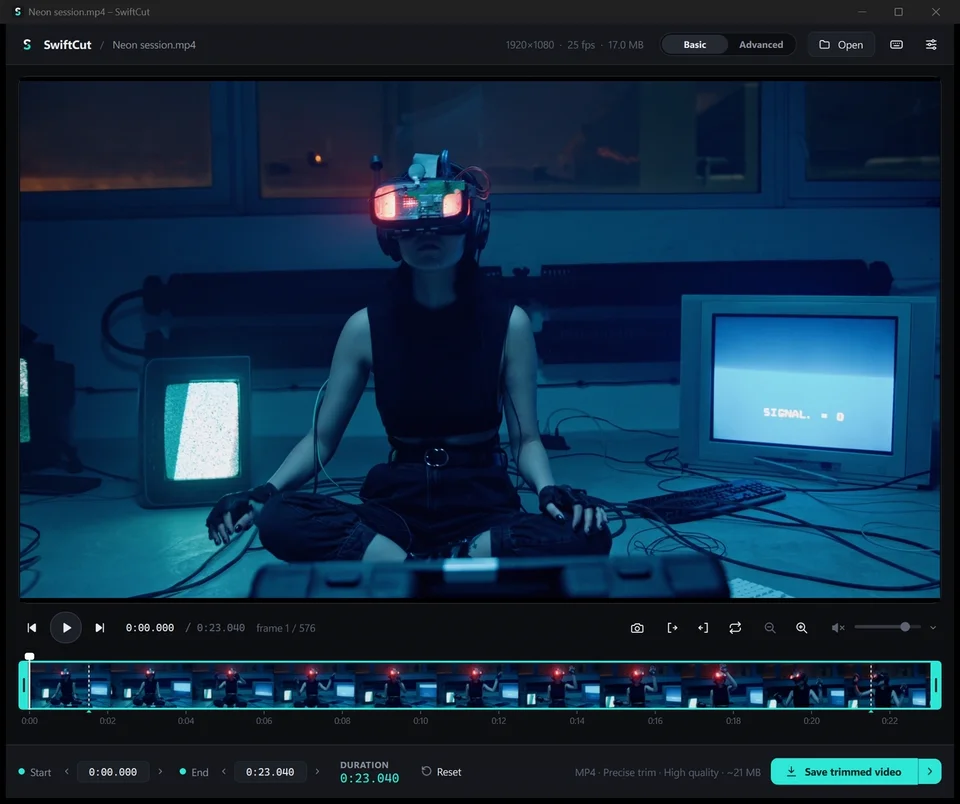
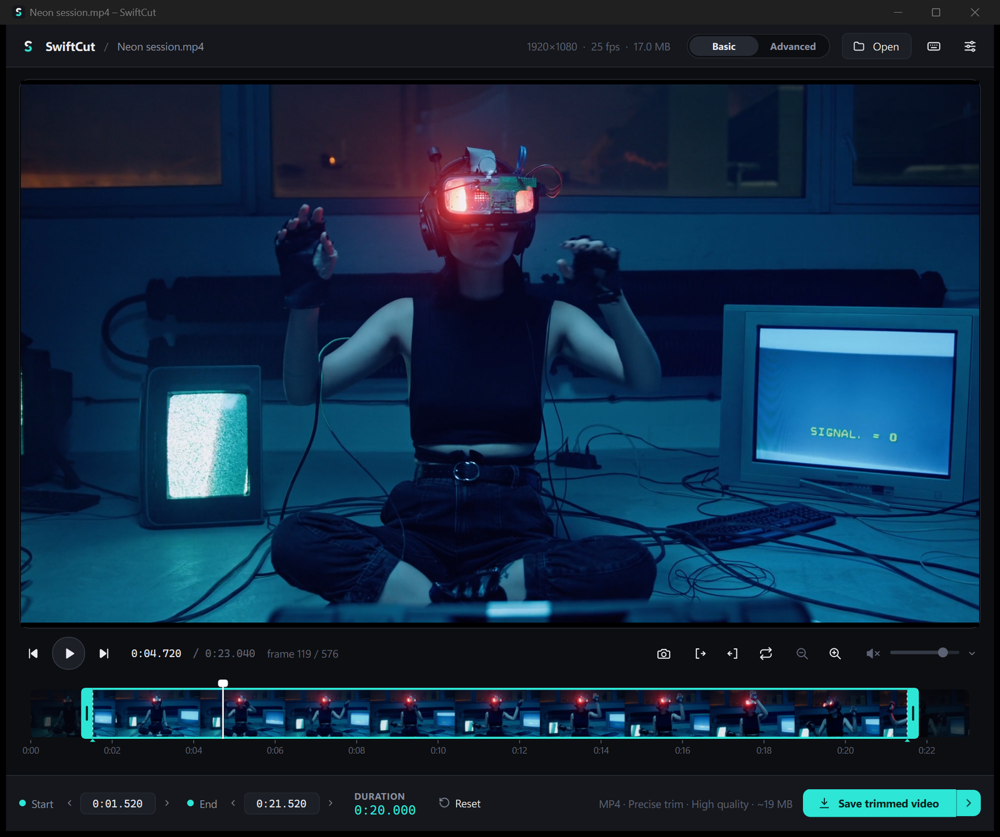

<h1 align="center">SwiftCut</h1>

A small, fast Windows app for trimming the start and end of a video, accurate to the frame.

  
  
  
  

<a href="https://github.com/swiftredvox/SwiftCut/releases/latest"><b>⬇ Download SwiftCut for Windows</b></a>

Open a recording, drag two handles to the part you want to keep, check it, and save. There are
no projects, tracks, accounts or adverts, and nothing goes online. Made for trimming screen
recordings, and it works with most videos.

## Download

Get the latest version from the **[Releases page](https://github.com/swiftredvox/SwiftCut/releases)**:

- **`SwiftCut-x.y.z-Setup.exe`** (recommended) installs for your user only, with no admin rights
  needed. It adds a Start menu entry, an optional desktop shortcut and an optional
  *Trim with SwiftCut* right-click entry for video files, and it uninstalls cleanly.
- **`SwiftCut-x.y.z-portable.zip`**: unzip anywhere and run `SwiftCut.exe`. Nothing is installed.

Requires 64-bit Windows 10 or 11. Everything else (including FFmpeg) is bundled.

### Windows warnings

SwiftCut is a free, open-source, zero-budget project, so it isn't code-signed (signing
certificates cost money every year). Because of that, Windows may be cautious the first time you
run it:

- **"Windows protected your PC"** (SmartScreen): click **More info → Run anyway**.
- **"Smart App Control blocked an app that may be unsafe"**: this has no override. Smart App
  Control is on mainly on PCs with a fresh Windows 11 install, and it blocks every unsigned app
  that Microsoft doesn't already know, not just SwiftCut. To run SwiftCut you have to turn it off:
  1. Open **Windows Security** (search for it in the Start menu).
  2. Go to **App & browser control → Smart App Control settings**.
  3. Choose **Off**.

  Only do this if you're comfortable with it. Turning it off removes a layer of protection for
  all apps. On up-to-date Windows 11 (April 2026 updates or later) you can turn it back on from
  the same page; on older versions, turning it back on required reinstalling Windows.

*Optional:* if you'd like to check your download is genuine, compare its SHA-256 hash with
`SHA256SUMS.txt` on the release page (in PowerShell: `Get-FileHash .\SwiftCut-x.y.z-Setup.exe`).
You don't need to do this to use SwiftCut.

## Features

- **Frame-accurate trimming.** Drag the handles, type exact times, nudge one frame at a time, or
  set start and end at the playhead. Saved videos start and end on exactly the frames you chose.
- **Suggested trim.** Recordings that start or end on a frozen screen get markers on the
  timeline; press **T** to skip the still parts.
- **Timeline zoom** (Ctrl + mouse wheel) for long videos, with a hover preview of any frame.
- **Save as you like.** Keep the original format or choose MP4, MOV, MKV or WebM with H.264,
  H.265 or VP9. NVIDIA GPU encoding is supported. You can fit the file under a size limit
  (e.g. 10 MB for chat apps), see an estimated size before saving, and remove metadata (dates,
  GPS location, titles).
- **GIF and animated WebP** export for sharing short clips.
- **Audio:** keep or drop audio, choose individual tracks, set the preview volume and pick an
  output device.
- **PNG snapshots** of any frame, undo/redo, and drag-and-drop.
- **Keyboard first,** with every shortcut remappable (F1). Classic editor keys and a left-hand
  WSAD layout work side by side.
- **Basic / Advanced modes:** sensible defaults, with more control when you want it.

## Using SwiftCut

1. **Open** a video: drag it onto the window, use **Open**, or right-click it in Explorer →
   *Trim with SwiftCut* (on Windows 11 that's under *Show more options*, or Shift + right-click).
2. **Trim**: drag the cyan handles. Hold **Shift** while dragging for fine control. You can also
   type times into *Start* / *End* and press **Return**.
3. **Check**: **Space** plays just the selection.
4. **Save**: *Save trimmed video* opens a normal Save As dialog with the original name filled
   in. The arrow next to it offers *Save as a copy* and *Save as GIF / WebP animation*.

| Action | Keys |
|---|---|
| Play / pause the selection | Space or K |
| Previous / next frame | ← → or A / D |
| Back / forward 1 second · 10 seconds | Shift + ← → · Ctrl + ← → (or with A / D) |
| Set start / end at the playhead | I / O, or Q / E |
| Apply suggested trim | T |
| Loop · preview audio on/off | L or W · M or S |
| Zoom timeline in / out / whole video | = / - / 0, or Ctrl + mouse wheel |
| Undo / redo | Ctrl+Z / Ctrl+Y |
| Save · save as animation · save frame as PNG | Ctrl+S · Ctrl+G · P |
| All shortcuts (and change them) | F1 |

## Privacy

SwiftCut works entirely on your PC and **never connects to the internet**. It has no telemetry
and no update checks. Use *Settings → About → Releases page* to look for new versions. Settings
are stored in `HKCU\Software\SwiftCut`, and a small log (under 1 MB) in
`%LOCALAPPDATA%\SwiftCut\logs`, which *Settings → Clear logs* empties. Uninstalling removes both.

## Reporting a problem

SwiftCut is a personal project, **provided as-is and updated occasionally**. Bug reports and
ideas are welcome and help decide what goes into future updates:
**Settings → About → Report a problem** opens a pre-filled form (or use
[Issues](https://github.com/swiftredvox/SwiftCut/issues)). For security issues, see
[SECURITY.md](SECURITY.md).

## Building from source

See [docs/DEVELOPMENT.md](docs/DEVELOPMENT.md). In short: Python 3.12, `setup.bat`, then
`run.bat`; `packaging\release.ps1` builds the installer and ZIP.

## Licence

SwiftCut is released under the [MIT licence](LICENSE), © 2026 SwiftRedVox. It bundles
[Qt](https://www.qt.io/) (LGPL-3.0), [FFmpeg](https://ffmpeg.org/) (GPL-3.0) and Python (PSF).
Their licences and source links are in [THIRD_PARTY_NOTICES.md](THIRD_PARTY_NOTICES.md), and
each release includes the matching FFmpeg source archive.

The footage in the screenshot and demo is from [Pexels](https://www.pexels.com/), used under the
Pexels licence.
